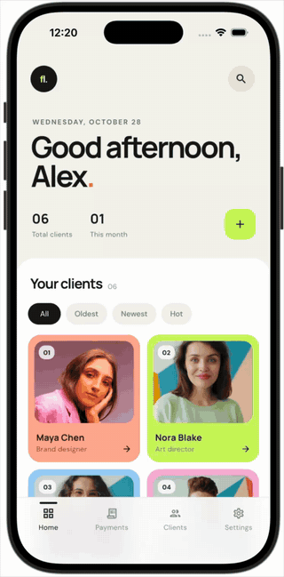
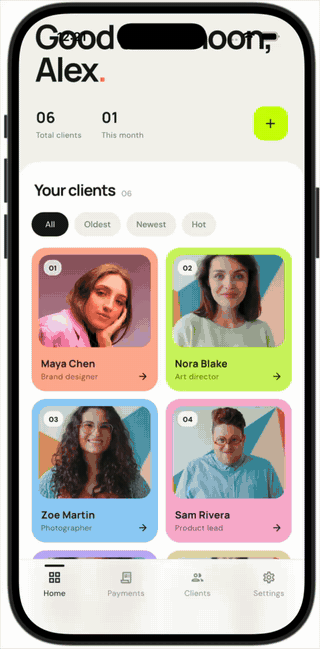

# Clientele

[](https://github.com/gryllifish/clientele/actions/workflows/ci.yml)
[](LICENSE)

A 3-screen Flutter demo focused on **smooth animations** and a **clean,
modern UI**, built on a production-grade architecture.

**[▶ Try the live demo](https://gryllifish.github.io/clientele/)** (web
build; on a desktop it opens inside a phone frame).

| Animated filters | Hero to profile | Payments |
|:---:|:---:|:---:|
|  |  |  |

## What it shows
- **Animated grid filtering.** Switching between All / Oldest / Newest / Hot
  doesn't rebuild the grid: each card slides to its new slot, removed cards
  fade out in place and new ones fade and scale in
  ([`animated_client_grid.dart`](lib/features/clients/presentation/widgets/animated_client_grid.dart)).
- **Hero transition.** Tapping a client flies their photo into the profile
  while its corners morph from the card's radius to the portrait's arch
  ([`client_photo.dart`](lib/features/clients/presentation/widgets/client_photo.dart)).
- **Payments tab.** A dark statement where the 30-day total counts up and
  payment cards rise in one by one, sharing the grid's entrance
  ([`rise_in.dart`](lib/shared/widgets/rise_in.dart)). Each profile links
  to the same tab narrowed to that client.
- **Search.** The search button unfolds into a field; typing narrows the
  grid with the same animation, and filters apply on top of the matches.
- **Polished details:** frosted bottom bar, animated chips and counters,
  staggered entrances, and a short notice on controls that are outside
  the demo's scope instead of dead buttons.
- **Accessibility:** honors the OS "Reduce motion" setting (pages, the
  Hero, the grid and counters switch instantly), semantic labels on cards
  and totals, and fonts bundled with the app instead of fetched at
  runtime.
- **Clean architecture:** feature-first layers, repository pattern, typed
  errors with `Result`/`Failure`, and Riverpod controllers. No business
  logic lives in widgets.
- **i18n:** English and Spanish, with locale-aware dates.

## Architecture
```
presentation → controllers → domain ← data
  widgets       @riverpod      entities   DTOs, data sources,
                notifiers      repo       repository impls
                               interfaces
```
- **State/DI:** Riverpod 3 with code generation.
- **Models:** freezed + json_serializable. DTOs are mapped to domain
  entities explicitly.
- **Errors:** data sources throw `AppException`; repositories return
  `Result<T>` through `guard()`; the UI renders localized `Failure`
  messages.
- **Routing:** go_router. **Lints:** very_good_analysis.

```
lib/
├── app/        App widget, bootstrap, router
├── core/       config, constants, error, l10n, router, theme, utils
├── shared/     cross-feature providers and widgets
└── features/
    ├── clients/{data,domain,controllers,presentation}
    └── transactions/{data,domain,controllers,presentation}
```

## Getting started
Requires Flutter 3.44+.

```sh
flutter pub get
cp env/dev.json.example env/dev.json        # optional
flutter run --dart-define-from-file=env/dev.json
```

Generated code is committed, so the app runs right after cloning. After
changing annotated classes or ARB files:

```sh
dart run build_runner build --delete-conflicting-outputs
```

## Quality gate
```sh
scripts/verify.sh   # pub get, codegen, l10n, format, analyze, test
```
- **Unit tests** cover domain rules, data sources (including the bundled
  JSON), repositories and controllers.
- **Widget tests** drive the real app on fixture data: filtering,
  searching, navigating to a profile and the statement, Reduce motion
  and the desktop frame.
- **CI** runs the same gate on every push and PR, checks that generated
  files are committed, and deploys the web demo from `main`.

## Credits
Client photos from [Unsplash](https://unsplash.com) (Unsplash License).
Manrope and DM Sans are bundled under the SIL Open Font License
([`assets/google_fonts/`](assets/google_fonts/)).

## License
Code released under the [MIT License](LICENSE). Client photos keep their
own Unsplash License.
